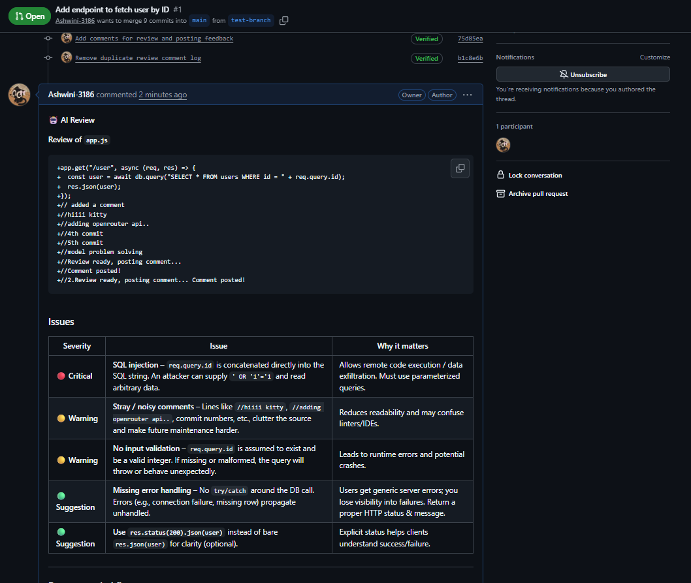
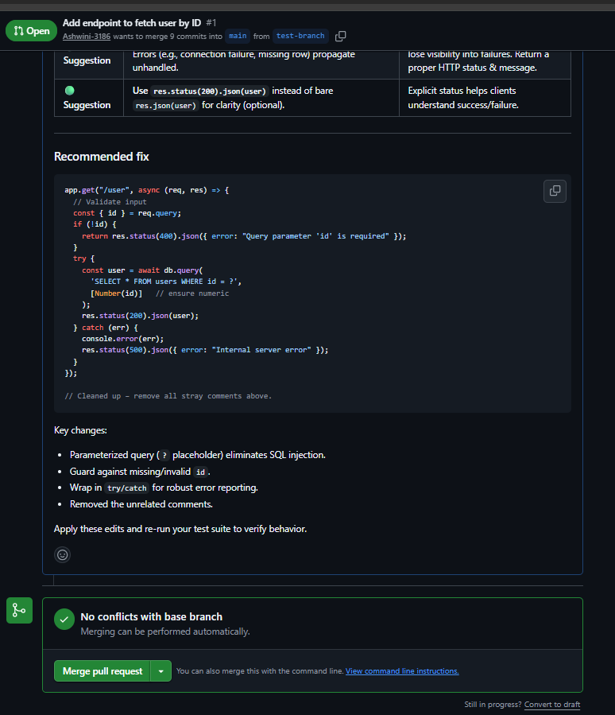
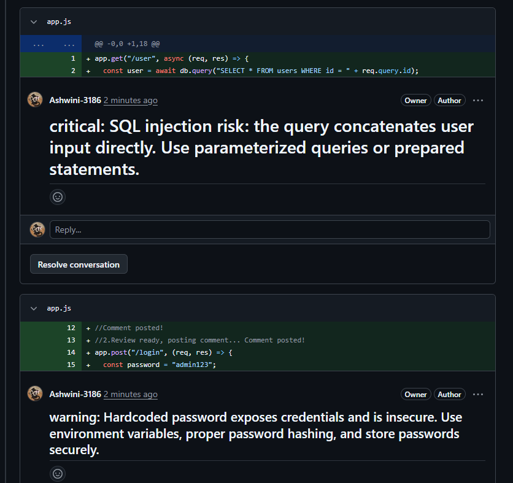

# 🤖 AI PR Reviewer

A GitHub bot that automatically reviews pull requests using an LLM and posts feedback as a comment on the PR.





## What it does
When a pull request is opened or updated, the bot:
1. Receives a GitHub webhook (verified using HMAC signature)
2. Fetches the PR diff through the GitHub API
3. Sends the diff to an LLM and gets a review (bugs, security issues, bad practices)
4. Posts the review back on the PR, tagged by severity (🔴 critical, 🟡 warning, 🟢 suggestion)

## Tech stack
Node.js, Express, Octokit (GitHub API), OpenRouter (LLM API)

## Key features
- Webhook signature verification so only genuine GitHub requests are accepted
- Retry with fallback models when the LLM provider is rate-limited
- Large diffs are truncated before being sent to the model
- Inline review comments on the exact lines, with severity tags (critical / warning / suggestion)
- Diff is annotated with line numbers and the LLM returns structured JSON; invalid line references are filtered out so GitHub never rejects the review
- Falls back to a single summary comment if the LLM output can't be parsed

## Setup
```bash
Requires Node.js 18+ (uses the built-in `fetch`).
git clone https://github.com/Ashwini-3186/pr-reviewer.git
cd pr-reviewer
npm install
```
Create a `.env` file:
```
GITHUB_TOKEN=your_github_token
WEBHOOK_SECRET=your_webhook_secret
OPENROUTER_API_KEY=your_openrouter_key
AI_MODEL=your_model_id
```
Run the server and expose it (for example with ngrok):
```bash
node index.js
ngrok http 3000
```
Then add a webhook to your repo (Pull requests event, payload URL `<ngrok-url>/webhook`).

## Roadmap
- [ ] GitHub App so anyone can install it
- [ ] Review history and dashboard
- [ ] Deployment